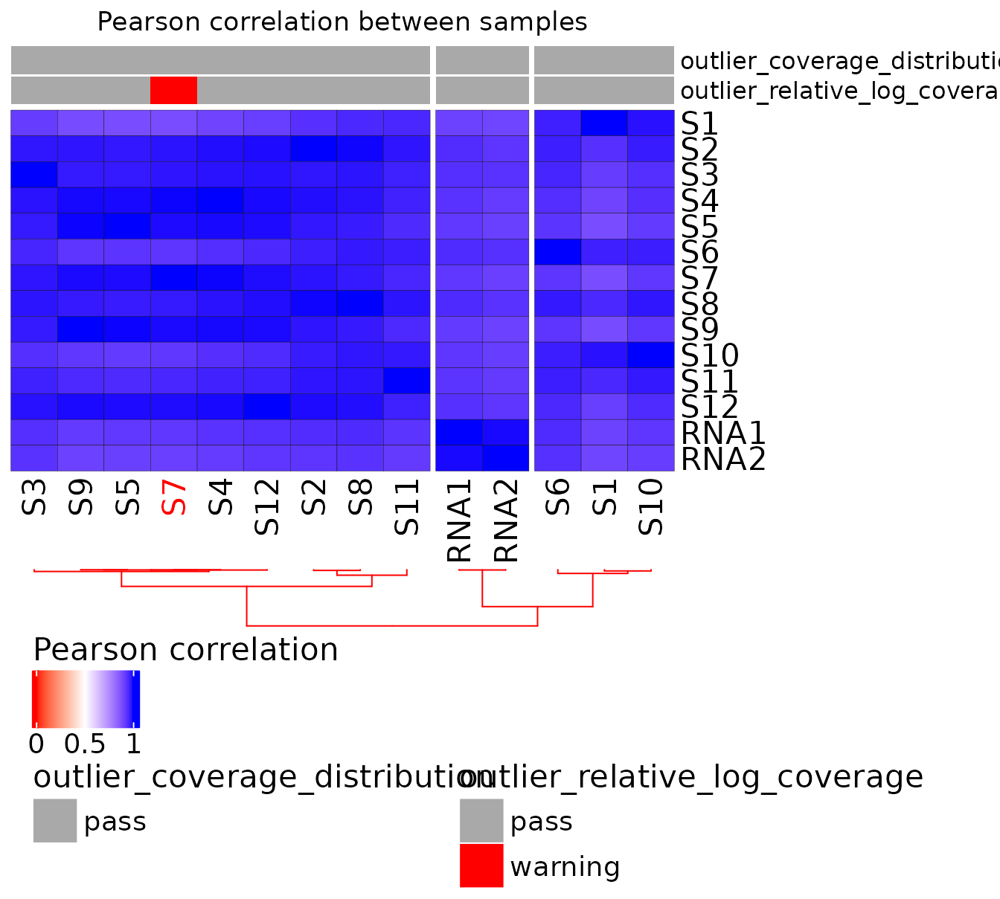
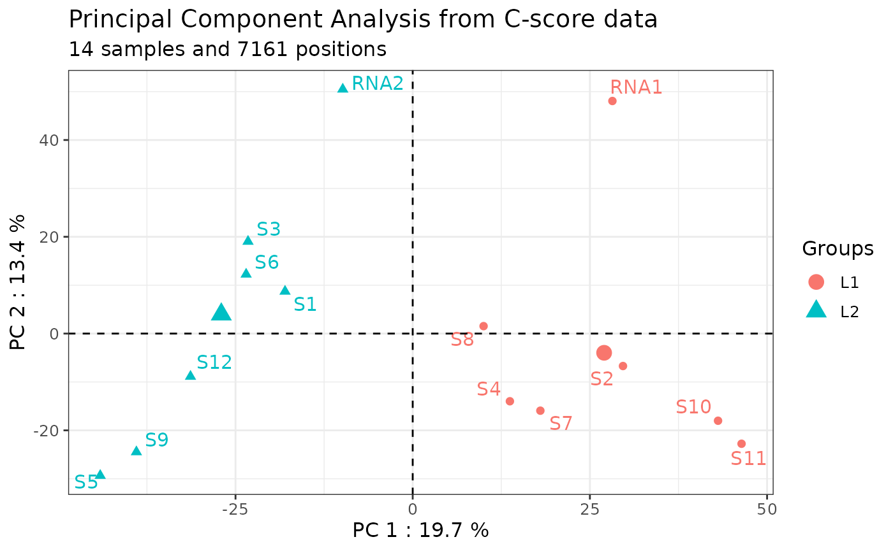
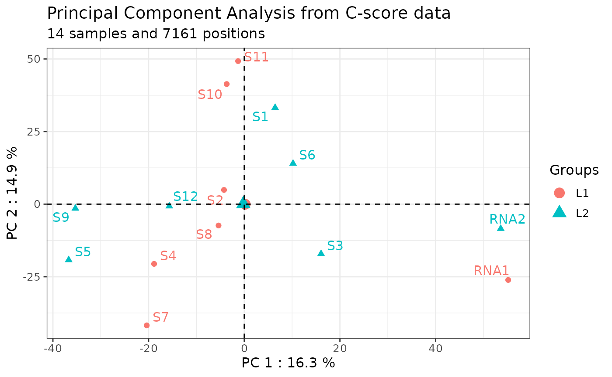
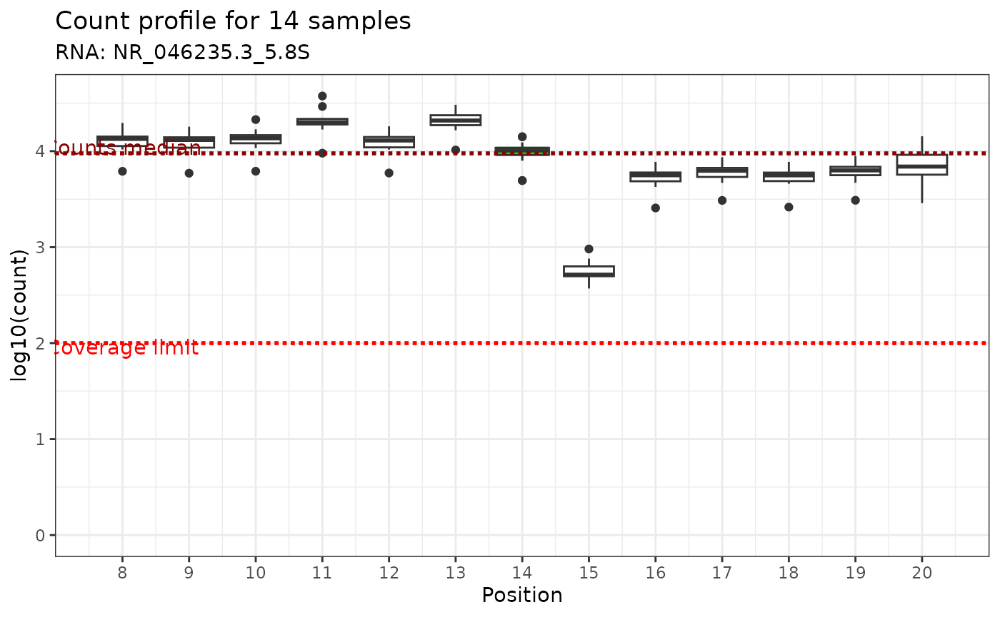
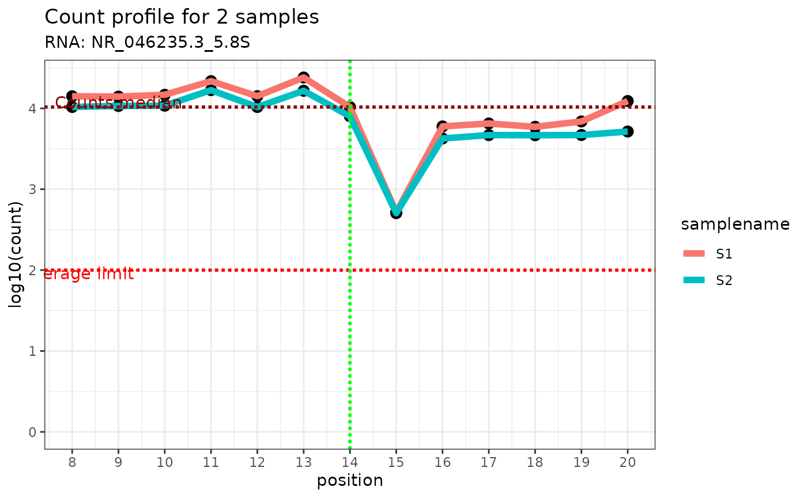
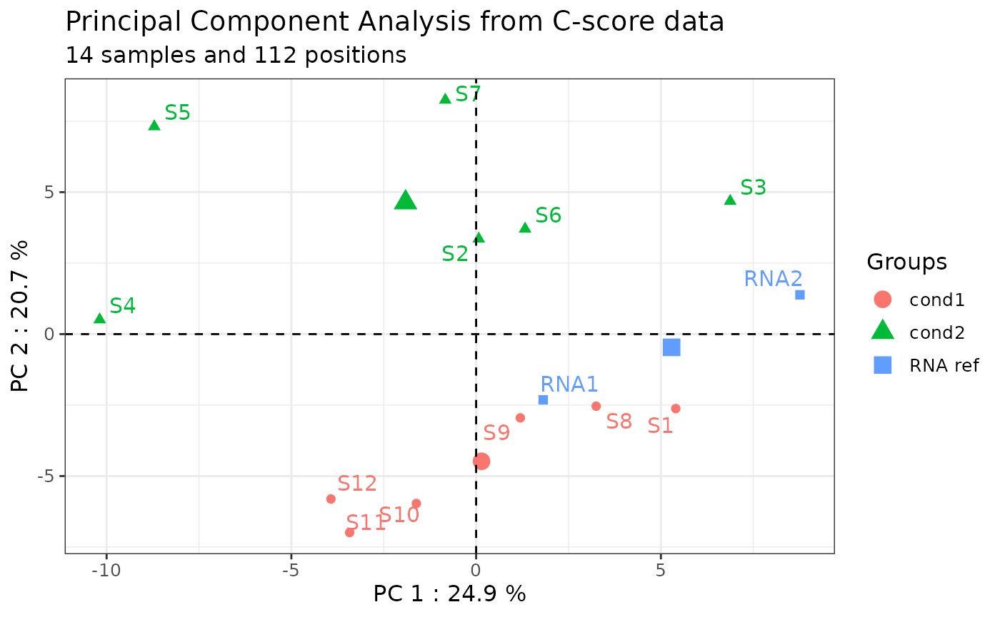
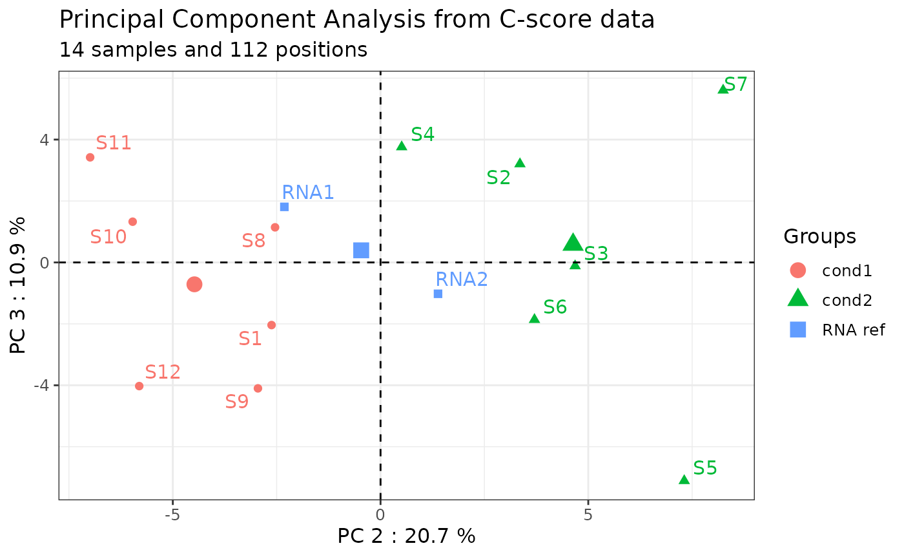

# rRMSAnalyzer: package to analyze RiboMethSeq data

Abstract

RiboMethSeq is an innovative RNAseq-based approach, which was developed
in 2015 to analyze 2’O-ribose methylation (2’Ome) at all sites of
ribosomal RNAs (rRNA) at once, in yeast (Birkedal et al. 2014). This
approach was then transferred to human using the Illumina technology
(Marchand et al. 2016; Erales et al. 2017; Marcel et al. 2021). Briefly,
the presence of 2’Ome protects the phosphodiester bond located at the 3’
of the 2’Ome nucleotide from alkaline hydrolysis. Thus, the presence of
2’Ome at the given nucleotide n induces under-representation of RNA
fragments starting at the nucleotide n+1 and an over-representation of
RNA fragments ending at the nucleotide n-1, allowing the extrapolation
of 2’Ome levels at the corresponding nucleotide position n (or C-score)
varying from 0 to 1 (Birkedal et al. 2014).  
  
The rRMSAnalyzer package can be used for any kind of RNA and with all
organisms. This package provides a set of user-friendly functions to
compute C-scores from RiboMethSeq read end counts as input, adjust batch
effect with ComBat-Seq, visualize the data and provide a table with the
annotated human rRNA sites and their C-scores. This package provides a
set of user-friendly functions to (i) compute C-scores from RiboMethSeq
read-end counts as input,(ii) perform quality control of the dataset,
(iii) adjust batch effect with ComBat-Seq, and (iv) provide tools to
visualize, analyze the data and provide a table with the annotated human
rRNA sites and their C-scores (Paraqindes et al., 2023), (v) return
automated QC and analytic reports. Raw data processing to obtain
read-end counts from sequencing data can be performed using our Nextflow
pipeline
[ribomethseq-nf](https://github.com/RibosomeCRCL/ribomethseq-nf), as
already described (Marchand et al. 2016).

## General information

### Help, bug reports and suggestions

To report a bug or any suggestion to improve the package, please let us
know by opening a new issue on:
<https://github.com/RibosomeCRCL/rRMSAnalyzer/issues>

### Acknowledgements

We would like to thank all our collaborators for their advice and
suggestions.

### Funding

This project has been funded by the French Cancer Institute (INCa, PLBIO
2019-138 MARACAS), the SIRIC Program (INCa-DGOS-Inserm_12563 LyRICAN)
and [Synergie Lyon Cancer
Foundation](https://www.synergielyoncancer.fr).

### Installation

The latest version of rRMSAnalyzer package can be installed from Github
with :

``` r

devtools::install_github("RibosomeCRCL/rRMSAnalyzer")
library(rRMSAnalyzer)
```

## Initial preparation of the dataset

### RiboClass

RiboClass is the main class of the package that enables the storage of
both the data matrices (read-end counts and C-scores) and the associated
metadata. It is automatically created when calling
*[`load_ribodata()`](https://ribosomecrcl.github.io/rRMSAnalyzer/reference/load_ribodata.md)*
(see [Loading data](#loading-data)).

It is a list containing three main elements, as described below:

1.  **Data**: a *list of dataframe*, containing for each sample the 5’
    and/or 3’ read-end counts provided by the user, and the calculated
    C-score.

2.  **Metadata**: a *dataframe*, containing all the information related
    to the samples that can be provided by the user.

3.  **rRNA_names**: a *dataframe*, reporting the names of the rRNA used
    in Data.

Some major function parameters (such as the normalization method used
for C-score computation) are also kept in the RiboClass object as a
reminder.

### Loading data

#### Data to provide

##### Read-end counts

To use this package, the user must provide at least one csv/tsv file
with the 5’, 3’ or 5’/3’ read-end counts resulting from RiboMethSeq data
per sample. The folder structure containing the csv files is not
important, as long as either the directory and its sub-directories
contain the necessary csv/tsv files.

1.  The **name of the rRNA** on which the read end counting was
    performed.

2.  The **position’s number** on the rRNA.

3.  The **value of the read-end counts** at the position.

Here is an example :

| rRNA | Position on rRNA | read end count |
|------|------------------|----------------|
| 18S  | 123              | 3746           |
| 18S  | 124              | 345            |
| 18S  | 125              | 324            |
| 18S  | 126              | 789            |
| 18S  | 127              | 1234           |

Note 1: it is not necessary to provide a header in the count files,
because column index can be used in the function *load_ribodata()*,
using *`count_value()`*, *`count_rnaid()`* and *`count_pos()`*
arguments.

Note 2: if no metadata is specified (metadata = NULL), rRMSAnalyzer will
try to fetch any csv files in the folder specified in count_path and its
subfolders.

##### Metadata

The expected metadata is either a dataframe already in the R environment
or a csv/tsv file.

*Two columns are mandatory for the metadata :*

1.  **filename**: name of the csv file on disk containing the read-end
    counts described above. Do not modify it unless the filename has
    changed on disk.

2.  **samplename**: rename the samples that will be analyzed and
    displayed on the plots. This column can be modified, as long as the
    sample names are unique.

After these two mandatory columns, the user can provide as many columns
as needed for the analysis.

Here is an example of metadata for 3 samples:

[TABLE]

Note: if no metadata is provided in
*[`load_ribodata()`](https://ribosomecrcl.github.io/rRMSAnalyzer/reference/load_ribodata.md)*
(metadata = NULL), an empty metadata will be created with the “filename”
and “samplename” columns pre-filled. The “samplename” column will be
identical to “filename”, but can be modified by the user.

Here is an example of auto-generated metadata:

| filename    | samplename  |
|-------------|-------------|
| sample1.csv | sample1.csv |
| sample2.csv | sample2.csv |
| sample3.csv | sample3.csv |

##### How to load the data

To load both data and metadata, and store them in a RiboClass, the
function
*[`load_ribodata()`](https://ribosomecrcl.github.io/rRMSAnalyzer/reference/load_ribodata.md)*
is used.

The following example displays a call to
*[`load_ribodata()`](https://ribosomecrcl.github.io/rRMSAnalyzer/reference/load_ribodata.md)*,
with all arguments shown :

``` r

path <- system.file("extdata", package="rRMSAnalyzer") #change for your path

ribo <- load_ribodata(
                      #data & metadata files path
                      count_path = file.path(path,"miniglioma/"),
                      metadata = file.path(path,"metadata.csv"),
                      # data & metadata files separator
                      count_sep = "\t",
                      metadata_sep = ",",
                      # count data arguments :
                      count_header = FALSE,
                      count_value = 3,
                      count_rnaid = 1,
                      count_pos = 2,
                      # Metadata arguments :
                      metadata_key = "filename",
                      metadata_id = "samplename",
                      # C-score arguments :
                      flanking = 6,
                      method = "median",
                      ncores = 1)
#> ✔ Your data has been successfully loaded!
```

### rRNA names

#### Provided

rRNA names are automatically obtained from the data and stored in a
generated dataframe inside the RiboClass. It contains two columns :

1.  **original_name**: original name of each rRNA (e.g NR_023363.1).

2.  **current_name**: current name of each rRNA, reflecting any user’s
    change with
    *[`rename_rna()`](https://ribosomecrcl.github.io/rRMSAnalyzer/reference/rename_rna.md)*
    function (see \[Rename RNA\]).

This dataframe is used to keep track of the original name, which often
includes the NCBI’s accession ID.

Here is an example:

| original_name    | current_name |
|------------------|--------------|
| NR_023363.1_5S   | 5S           |
| NR_046235.3_5.8S | 5.8S         |
| NR_046235.3_18S  | 18S          |
| NR_046235.3_28S  | 28S          |

#### Custom

The user must not modify this dataframe manually. To rename or remove
rRNA, the user can use
*[`rename_rna()`](https://ribosomecrcl.github.io/rRMSAnalyzer/reference/rename_rna.md)*
and
*[`remove_rna()`](https://ribosomecrcl.github.io/rRMSAnalyzer/reference/remove_rna.md)*.
The dataframe will be updated accordingly.

### C-score calculation

#### What is a C-score ?

The C-score is a metric, calculated from the RiboMethSeq sequencing
data, used to evaluate the level of 2’O-ribose methylation (2’Ome) at a
given position in the rRNA.

The C-score is calculated by normalizing the end read count with respect
to the local environment at each genomic position and directly indicates
the rRNA 2’Ome level. The C-score ranges from 0 (i.e., no rRNA molecules
of the sample are 2’Ome at this specific site) to 1 (i.e., all rRNA
molecules of the sample are 2’Ome at this specific site). A C-score with
an intermediate value between 0 to 1 means that the sample contains a
mixture of un-2’Ome and 2’Ome rRNA molecules.

To obtain a robust estimate of the 2’Ome level, different C-scores can
be determined depending on the arguments used to compute the local
coverage. In particular, the estimation method and the size of the local
coverage to be considered can be changed.

By default, the local coverage is estimated by calculating the
**median** of the **5’ read-end counts** in a **flanking region of 6**
(i.e., 6 nucleotides downstream the nucleotide n and 6 upstream the
nucleotide n, where n is the nucleotid directly following the 2’Ome site
of interest). This package provides the ability to change these two
arguments either when loading the data or during the analysis.

##### C-score computation when loading data

When using the
*[`load_ribodata()`](https://ribosomecrcl.github.io/rRMSAnalyzer/reference/load_ribodata.md)*
function, a C-score is automatically calculated for all genomic
positions of the rRNA. The C-score is computed using either the default
arguments of the
*[`load_ribodata()`](https://ribosomecrcl.github.io/rRMSAnalyzer/reference/load_ribodata.md)*
function or user-defined arguments as follows:

``` r

load_ribodata(count.path = "/path/to/csv/",
              metadata = "/path/to/metadata.csv",
              # everything below is linked to C-score computation
              flanking = 6, # flanking region size
              method = "median", # use mean or median on flanking region's values
              ncores = 8 # number of CPU cores to use for computation
              )
```

##### C-score computation during the analysis

During the analysis, the C-score calculating arguments (method and size
of the flanking region) can be modified using the
*[`compute_cscore()`](https://ribosomecrcl.github.io/rRMSAnalyzer/reference/compute_cscore.md)*
function, which will automatically update the C-score in the RiboClass.

In the following example, both the flanking region’s size of the local
coverage and the computation method have been modified:

``` r

# Compute the C-score using different arguments,
# including calculation of the local coverage using the mean instead of the median
ribo <- compute_cscore(ribo,
                       flanking = 4,
                       method = "mean")
```

**Important: this function will override the previous C-score of the
RiboClass.**

## Quality control

Due to technical limitations, it is sometimes necessary to conduct
wet-lab preparations of large cohorts in several batches. The main risk
when making several batches is to introduce **technical biases** or
**batch effect** in the dataset.

### Content of the QC report

A quality control (QC) report can be performed. It uses several metrics
to help identify outlier samples and/or batch effects, including
read-end counts and the C-score itself at all the 7217 genomic
positions. The QC verifies that the coverage is uniform and reproducible
between samples, eliminating the possibility of bias due to sequencing
and outliers.

QC can be either performed using a panel of ready to use functions,
which correspond to data visualization, or automatically.

The automatic QC report can be generated using the
*[`report_qc()`](https://ribosomecrcl.github.io/rRMSAnalyzer/reference/report_qc.md)*
function:

With the ribo_toy example, the column that contains the information
about samples batches is called “run”. The name is thus given to the
*`library_col`* argument but it can be also left empty.

``` r

report_qc(ribo = ribo_toy, library_col = "run")
```

The QC report includes the following visualizations:

- Read-end counts distribution by sample
  (*[`boxplot_count()`](https://ribosomecrcl.github.io/rRMSAnalyzer/reference/boxplot_count.md)*)
- Relative log coverage (i.e., end read count) by sample
  (*[`plot_rlc()`](https://ribosomecrcl.github.io/rRMSAnalyzer/reference/plot_rlc.md)*)
- rRNA fraction of read-end counts per sample
  (*`plot_count_fraction()`*)
- Heatmap summarizing the correlation matrix of the read-end counts
  (*`heatmap_annotated()`*)
- Correspondence analysis of the read-end counts
  (*[`plot_coa()`](https://ribosomecrcl.github.io/rRMSAnalyzer/reference/plot_coa.md)*)
- Principal component analysis
  (*[`plot_pca()`](https://ribosomecrcl.github.io/rRMSAnalyzer/reference/plot_pca.md)*)

#### Correlation matrix

To add outlier annotations on the heatmap,
*[`get_outliers()`](https://ribosomecrcl.github.io/rRMSAnalyzer/reference/get_outliers.md)*
function must be used. This function computes all the outliers
identified in the QC and returns a data frame summary for use in
*[`plot_heatmap_annotated()`](https://ribosomecrcl.github.io/rRMSAnalyzer/reference/plot_heatmap_annotated.md)*

Here is an example of correlation matrix with outlier identification:

``` r

qcdata <- rRMSAnalyzer::get_outliers(ribo)
plot_heatmap_annotated(ribo, qcdata)
```



#### Output of the QC report

Information issued from the QC report can be return as followed:

Here is an example of QC output:

``` r

output_dir <- getwd()
# To display the output
knitr::kable(qcdata, "html") %>% kable_styling("striped") %>% scroll_box(width = "100%", height = "500px")
```

|  | samplename | condition | run | filename | median_coverage | coverage_quality | rlc_median | rlc_median_quality | total_outliers |
|:---|:---|:---|:---|:---|---:|:---|---:|:---|:---|
| S1 | S1 | cond1 | L2 | S1_5_counts.csv | 1761 | pass | 0.0575140 | pass | 0 |
| S2 | S2 | cond2 | L1 | S2_5_counts.csv | 1292 | pass | -0.3439012 | pass | 0 |
| S3 | S3 | cond2 | L2 | S3_5_counts.csv | 2212 | pass | 0.3954259 | pass | 0 |
| S4 | S4 | cond2 | L1 | S4_5_counts.csv | 2147 | pass | 0.3337012 | pass | 0 |
| S5 | S5 | cond2 | L2 | S5_5_counts.csv | 1682 | pass | -0.0113976 | pass | 0 |
| S6 | S6 | cond2 | L2 | S6_5_counts.csv | 1774 | pass | 0.0499721 | pass | 0 |
| S7 | S7 | cond2 | L1 | S7_5_counts.csv | 696 | pass | -1.2547609 | warning | 1 |
| S8 | S8 | cond1 | L1 | S8_5_counts.csv | 1759 | pass | 0.0618611 | pass | 0 |
| S9 | S9 | cond1 | L2 | S9_5_counts.csv | 1394 | pass | -0.2504866 | pass | 0 |
| S10 | S10 | cond1 | L1 | S10_5_counts.csv | 1625 | pass | -0.0767012 | pass | 0 |
| S11 | S11 | cond1 | L1 | S11_5_counts.csv | 1632 | pass | -0.0471291 | pass | 0 |
| S12 | S12 | cond1 | L2 | S12_5_counts.csv | 1683 | pass | 0.0062753 | pass | 0 |
| RNA1 | RNA1 | RNA ref | L1 | RNA1_5_counts.csv | 1593 | pass | -0.1061994 | pass | 0 |
| RNA2 | RNA2 | RNA ref | L2 | RNA2_5_counts.csv | 2316 | pass | 0.3822330 | pass | 0 |

``` r

# To save the output
write.table(qcdata,file.path(output_dir,"quality_control.csv"),sep="\t",row.names=FALSE,quote = FALSE)
```

#### Comments

A Comments section is available in the QC report to add some personal
comments. To do so, a Rmarkdown file should be created and saved in the
working directory. Then, path to this report should be given in the
*comments* argument of the
*[`report_qc()`](https://ribosomecrcl.github.io/rRMSAnalyzer/reference/report_qc.md)*
function.

``` r

report_qc(ribo = ribo, specie = "human", library_col = "run", comments = "./path/to/comment_QC.Rmd")
```

Example of comments in rmd extension

``` r
```{=html} 
<style type="text/css">
  body {
    font-family: Helvetica;
  }

  /* Apply a skyblue background to the blocks <details> */
  details {
    background-color: #9ecae1;
    padding: 10px;
    border-radius: 5px;
  }
</style>
``` # erase this '#' and this sentence
<details>

<summary><b> ℹ Comments on the report  </b></summary>
<div markdown="1">
<p>
Text can be entered from here ...

Subtitle can be added with '##' symbol:

## 5.3 Level 2 title {-} #this symbol {-} avoid continue the numbering of the table of content

...to here. Those last 2 lines below must be kept. They are usefull for the layout.
</div>
</details>
  
#copy/past in an rmd file
#apply in the report_qc() function
#report_qc(ribo = ribo….)
```

### Batch effect

#### Batch effect identification

Technical bias (i.e., batch effect) can be identified by plotting
C-scores at all the genomic positions of the rRNA for each sample on a
PCA (see also \[Visualization with PCA\] for more uses).

Since more than 1.5% of the C-score corresponds to non-biological noise,
normalization during C-score calculation should limit the dispersion of
the samples based on their C-score at all genomic positions in the whole
series. Thus, Principal Component Analysis (PCA) on C-scores helps to
identify putative batch effects that can be corrected using the
inter-normalization option (ComBat-seq tool) (Zhang et al, 2020;
Paraqindes et al, 2023).  
  
The graph shows a Principal Component Analysis (PCA) plot illustrating
the distance between each sample based on its C-score at all genomic
positions. The samples are colored by library.

Here is an example:

``` r

# Plot a Principal Component Analysis (PCA) whose colors depend on the "run" column in metadata
plot_pca(ribo = ribo,
         color_col = "run")
```



In this example, the technical replicates RNA1 and RNA2 included in
library 1 and 2 respectively, are distant from each other on the PC1
axis. Moreover, the samples should not be grouped by library or batch.
The following section will resolve this batch effect.

#### Batch effect adjustment

Batch effect of RiboMethSeq data can be adjusted using the ComBat-seq
method (Paraqindes et al, 2023 ; Zhang, et al, 2020). The rRMSAnalyzer
package includes a wrapper (adjust_bias) to perform ComBat-seq
adjustment which provides a new RiboClass with adjusted read end count
values and C-scores automatically recalculated with the same setup
arguments.

``` r

data("ribo_toy")
# If necessary, adjust any technical biases using ComBat-Seq.
# Here, as an example, we use the "run" column in metadata.
ribo_adjusted <- adjust_bias(ribo_toy, batch = "run")
#> Found 2 batches
#> Using null model in ComBat-seq.
#> Adjusting for 0 covariate(s) or covariate level(s)
#> Estimating dispersions
#> Fitting the GLM model
#> Shrinkage off - using GLM estimates for parameters
#> Adjusting the data
#> Recomputing c-score with the following parameters :
#> - C-score method : median
#> - Flanking window : 6
```

Batch effect adjustment can be verified using the plot_pca function on
the new RiboClass:

``` r

plot_pca(ribo_adjusted,"run")
```



After batch effect adjustment using ComBat-seq method, the two technical
replicates RNA1 and RNA2 show reduced dispersion, and the samples are
separated on the PCA axes independently of the library they belong to.

### Verifying local coverage

The C-score depends on the local coverage around the site. For a simple
visualization of the read end count coverage of the flanking region of a
given genomic position of interest, use the
[`plot_counts_env()`](https://ribosomecrcl.github.io/rRMSAnalyzer/reference/plot_counts_env.md)
function. Two plotting methods are available:

1.  **display all samples** (default arguments): by displaying the end
    read count coverage of all samples using a boxplot at the +/-6
    genomic position relative to the genomic position of interest (green
    box). A pink box is displayed if there is other modification in the
    window. Such a plot is automatically used when samples = “all”. The
    median of the read end count and coverage limit are shown as two
    dashed red lines.

Here is an example:

``` r

plot_counts_env(ribo_adjusted,"NR_046235.3_5.8S",14)
```



2.  **sample of interest**: by displaying the end read count coverage of
    the sample of interest only using the profile at the +/-6 genomic
    position relative to the genomic position of interest (vertical
    green line). The median of the read end count is displayed as a
    horizontal dotted red line.

Here is an example:

``` r

plot_counts_env(ribo_adjusted,"NR_046235.3_5.8S",14,c("S1","S2"))
```



## Data formatting for subsequent analyses

### Sample manipulation

#### Keep or remove samples

A sample subset can be easily analyzed by specifying which samples to
keep or which to remove. The user can then create a new RiboClass object
containing the data and metadata of the samples of interest. In both
cases, only the metadata of the remaining samples are kept in the
RiboClass object, so no manual updating is required.

Here is an example of how to create a new RiboClass by retaining two
samples of interest (“S1” and “S2”):

``` r

ribo_2samples <- keep_ribo_samples(ribo_adjusted,c("S1","S2"))
print(ribo_2samples)
#> a RiboClass with 2 samples and 4 RNA(s) :
#> Name : NR_023363.1_5S, length : 121
#>  Name : NR_046235.3_5.8S, length : 157
#>  Name : NR_046235.3_18S, length : 1869
#>  Name : NR_046235.3_28S, length : 5070
```

Here is an example to generate a new RiboClass by removing two samples
(“RNA1” and “RNA2”):

``` r

ribo_adjusted <- remove_ribo_samples(ribo_adjusted,c("RNA1","RNA2"))
print(ribo_adjusted)
#> a RiboClass with 12 samples and 4 RNA(s) :
#> Name : NR_023363.1_5S, length : 121
#>  Name : NR_046235.3_5.8S, length : 157
#>  Name : NR_046235.3_18S, length : 1869
#>  Name : NR_046235.3_28S, length : 5070
```

In both cases, only the remaining samples’ metadata are kept in the
RiboClass object. There is no need to update it manually.

### rRNA manipulation and annotation

#### rRNA manipulation

##### Remove rRNA

A subset of rRNA can be easily analyzed by specifying the rRNA to be
removed. The user can thus create a new RiboClass object containing the
data of the rRNAs of interest, without affecting the metadata of the
samples.

Here is an example where the rRNA 5S is removed:

``` r

ribo_adjusted <- remove_rna(ribo, rna_to_remove = "NR_023363.1_5S")
print(ribo_adjusted)
#> a RiboClass with 14 samples and 3 RNA(s) :
#> Name : NR_046235.3_5.8S, length : 157
#>  Name : NR_046235.3_18S, length : 1869
#>  Name : NR_046235.3_28S, length : 5070
```

#### Rename rRNA

The annotation of rRNA 2’Ome sites using the lists provided by this
package requires the use of specific rRNA names.

Here is an example to check if the rRNA names provided by the user in
the RiboClass match the ones used by this package :

``` r

data("human_methylated")
cat("human_methylated's rna names: ", unique(human_methylated$rRNA),"\n")
#> human_methylated's rna names:  5.8S 18S 28S
cat("ribo's rna names: ", as.character(ribo_adjusted$rna_names$current_name))
#> ribo's rna names:  NR_046235.3_5.8S NR_046235.3_18S NR_046235.3_28S
```

In this example, the names are different and need to be updated before
annotation.

The
[`rename_rna()`](https://ribosomecrcl.github.io/rRMSAnalyzer/reference/rename_rna.md)
function automatically updates the rRNA names given by the rRNA size
order:

``` r

ribo_adjusted <- rename_rna(ribo_adjusted,
                            new_names = c("5.8S", "18S", "28S")) 
                            # from the shortest rRNA in our RiboClass to the longest.
```

### Annotation of rRNA 2’Ome sites

The rRMSAnalyzer package calculates a C-score for each genomic position
of the rRNAs. However, not every site of the reference 2’Ome rRNA is
necessarily methylated. Therefore, it is expected that the user provides
a list of potentially methylated sites of interest, called “annotated
sites”. This will make it easier to restrict further analysis to this
list of sites. By default, rRMSAnalyzer package includes its own human
annotated sites.

#### Included annotation : Human 2’Ome rRNA sites

By default, rRMSAnalyzer package includes three dataframes containing
the positions and the annotations of the human rRNA 2’Ome sites:

- human_methylated: a dataframe, containing the 112 known 2’Ome sites
  for the human rRNAs.

- human_suspected: a dataframe, containing the 17 sites that are
  putative 2’Ome sites for the human rRNAs, as described in the
  litterature.

- human_both_methylated_and_suspected: a dataframe, containing the 129
  sites of both known 2’Ome sites and sites that are putative 2’Ome
  sites for the human rRNAs.

#### Customize 2’Ome sites annotations

Instead of using the list of human rRNA 2’Ome sites provided by the
rRMSAnalyzer package, the user can provide their own list of annotated
sites which will be attached to the RiboClass object using the
[`annotate_site()`](https://ribosomecrcl.github.io/rRMSAnalyzer/reference/annotate_site.md)
function (see Section : annotation of rRNA 2’Ome sites).

This
[`annotate_site()`](https://ribosomecrcl.github.io/rRMSAnalyzer/reference/annotate_site.md)
function expects an “annot” argument which must be a dataframe object
that contains the following three mandatory columns :

- **RNA name**: the name of the rRNA, matching the rRNA name of the
  RiboClass.

- **Position on RNA**: the number of the position on the rRNA.

- **Nomenclature**: the name given to the site of interest.

You can see an example below :

| Position | rRNA | Nomenclature |
|----------|------|--------------|
| 15       | 5.8S | Um14         |
| 76       | 5.8S | Gm75         |
| 28       | 18S  | Am27         |

#### Annotate rRNA sites

The 2’Ome sites of interest must be attached to the RiboClass object for
further analysis using the
[`annotate_site()`](https://ribosomecrcl.github.io/rRMSAnalyzer/reference/annotate_site.md)
function with either the provided annotations or custom annotations (see
[Customize 2’Ome sites annotations](#customize-2ome-sites-annotations)).

Here is an example using the included human methylated annotations:

``` r

ribo_adjusted <- annotate_site(ribo_adjusted,
                               annot = human_methylated,
                               anno_rna = "rRNA",
                               anno_pos = "Position",
                               anno_value = "Nomenclature")
```

Note : rRMSAnalyzer will display a warning message when there is a
mismatch between the annot and RiboClass rRNA names.

This vignette also provides some explanations on how to create your own
sites annotation dataset with [Customize 2’Ome sites
annotations](#customize-2ome-sites-annotations).

### Analysis design for multiple comparisons

Although comparison of two groups can be computed using the analytic
report functions (e.g., report_2ome_sites or report_diff_sites – (see
\[2’Ome profiling report\] or [2’Ome site-by-site
report](#ome-site-by-site-report))) thanks to the “condition” column of
the metadata, this section needs to be considered to perform multiple
comparisons (i.e., more than 2 groups). The following section Addition
of new columns in the metadata is required for the two reports while the
section Comparison table is required for report_diff_sites only.

#### Addition of new columns in the metadata

To perform multiple group comparison, the metadata needs to be
implemented with additional information on the experimental conditions
in order to create as much as novel Riboclass required to perform all
the comparison. The metadata are stored in the RiboClass object once it
has been created. To change the metadata, (i) amend the metadata
csv.file used to create the RiboClass (see [How to load the
data](#how-to-load-the-data)) and (ii) recreate the RiboClass using the
*[`load_ribodata()`](https://ribosomecrcl.github.io/rRMSAnalyzer/reference/load_ribodata.md)*
function.

Here is an example:

The study includes 3 experimental conditions termed “variable A to C”
(e.g., wild-type, mutation 1, mutation 2) that has been exposed to
another condition termed “ctrl, P1 and P2” (e.g., untreated vs treatment
with 2 different concentrations). All these experimental conditions have
been performed in replicates termed “N”. In summary, it includes:

- VariableA (9 samples) has 1 control (ctrl) and 2 cases (P1 and P2)
  with 3 replicates for each (total = 9 samples).  
- VariableB (4 samples) has 1 control (ctrl) and 1 case (P2) with 2
  replicates for each (total = 4 samples).  
- VariableC (6 samples) has 1 control (ctrl) and 1 case (P2) with 3
  replicates for each (total = 6 samples).  

#### (i) Update of the metadata .csv file

-\>\>\> Here is the initial metadata in the RiboClass:

| filename            | samplename        | condition | treatment | lib |
|---------------------|-------------------|-----------|-----------|-----|
| S26_R1.5_counts.csv | variableB_N2_P2   | variableB | P2        | L2  |
| S27_R1.5_counts.csv | variableA_N2_P1   | variableA | P1        | L2  |
| S28_R1.5_counts.csv | variableC_N1_ctrl | variableC | ctrl      | L2  |
| S30_R1.5_counts.csv | variableB_N1_P2   | variableB | P2        | L2  |
| S31_R1.5_counts.csv | variableC_N2_P2   | variableC | P2        | L2  |
| S32_R1.5_counts.csv | variableA_N3_P1   | variableA | P1        | L2  |
| S33_R1.5_counts.csv | variableA_N3_ctrl | variableA | ctrl      | L2  |
| S34_R1.5_counts.csv | variableC_N3_ctrl | variableC | ctrl      | L2  |
| S35_R1.5_counts.csv | variableA_N1_P2   | variableA | P2        | L2  |
| S36_R1.5_counts.csv | variableA_N2_ctrl | variableA | ctrl      | L2  |
| S37_R1.5_counts.csv | variableC_N2_ctrl | variableC | ctrl      | L2  |
| S38_R1.5_counts.csv | variableA_N2_P2   | variableA | P2        | L2  |
| S39_R1.5_counts.csv | variableC_N1_P2   | variableC | P2        | L2  |
| S40_R1.5_counts.csv | variableB_N1_ctrl | variableB | ctrl      | L2  |
| S41_R1.5_counts.csv | variableA_N1_P1   | variableA | P1        | L2  |
| S42_R1.5_counts.csv | variableA_N1_ctrl | variableA | ctrl      | L2  |
| S43_R1.5_counts.csv | variableC_N3_P2   | variableC | P2        | L2  |
| S44_R1.5_counts.csv | variableB_N2_ctrl | variableB | ctrl      | L2  |
| S45_R1.5_counts.csv | variableA_N3_P2   | variableA | P2        | L2  |

-\>\>\> A simple way to format the metadata is to add three columns, one
for each experimental condition (i.e., termed “variable A to C” in this
example) in which the second experimental condition is implemented
(i.e., termed “ctrl, P1, P2” in this example).  
Here is an example of the first design of the novel metadata:

| filename | samplename | variableA | variableB | variableC | condition | treatment | lib |
|----|----|----|----|----|----|----|----|
| S26_R1.5_counts.csv | variableB_N2_P2 | NA | P2 | NA | variableB | P2 | L2 |
| S27_R1.5_counts.csv | variableA_N2_P1 | P1 | NA | NA | variableA | P1 | L2 |
| S28_R1.5_counts.csv | variableC_N1_ctrl | NA | NA | ctrl | variableC | ctrl | L2 |
| S30_R1.5_counts.csv | variableB_N1_P2 | NA | P2 | NA | variableB | P2 | L2 |
| S31_R1.5_counts.csv | variableC_N2_P2 | NA | NA | P2 | variableC | P2 | L2 |
| S32_R1.5_counts.csv | variableA_N3_P1 | P1 | NA | NA | variableA | P1 | L2 |
| S33_R1.5_counts.csv | variableA_N3_ctrl | ctrl | NA | NA | variableA | ctrl | L2 |
| S34_R1.5_counts.csv | variableC_N3_ctrl | NA | NA | ctrl | variableC | ctrl | L2 |
| S35_R1.5_counts.csv | variableA_N1_P2 | P2 | NA | NA | variableA | P2 | L2 |
| S36_R1.5_counts.csv | variableA_N2_ctrl | ctrl | NA | NA | variableA | ctrl | L2 |
| S37_R1.5_counts.csv | variableC_N1_ctrl | NA | NA | ctrl | variableC | ctrl | L2 |
| S38_R1.5_counts.csv | variableA_N2_P2 | P2 | NA | NA | variableA | P2 | L2 |
| S39_R1.5_counts.csv | variableC_N2_P2 | NA | NA | P2 | variableC | P2 | L2 |
| S40_R1.5_counts.csv | variableB_N1_ctrl | NA | ctrl | NA | variableB | ctrl | L2 |
| S41_R1.5_counts.csv | variableA_N1_P1 | P1 | NA | NA | variableA | P1 | L2 |
| S42_R1.5_counts.csv | variableA_N1_ctrl | ctrl | NA | NA | variableA | ctrl | L2 |
| S43_R1.5_counts.csv | variableC_N3_P2 | NA | NA | P2 | variableC | P2 | L2 |
| S44_R1.5_counts.csv | variableB_N3_ctrl | NA | ctrl | NA | variableB | ctrl | L2 |
| S45_R1.5_counts.csv | variableA_N3_P2 | P2 | NA | NA | variableA | P2 | L2 |

-\>\>\> If the analysis includes comparison of 2 conditions
independently of the other (e.g., all ctrl vs all P2), the addition of a
single column is required (i.e., “comp1” in this example).  
Here is an example of the second design of the novel metadata:

| filename            | samplename        | comp1 | condition | treatment | lib |
|---------------------|-------------------|-------|-----------|-----------|-----|
| S26_R1.5_counts.csv | variableB_N2_P2   | P2    | variableB | P2        | L2  |
| S27_R1.5_counts.csv | variableA_N2_P1   | NA    | variableA | P1        | L2  |
| S28_R1.5_counts.csv | variableC_N1_ctrl | ctrl  | variableC | ctrl      | L2  |
| S30_R1.5_counts.csv | variableB_N1_P2   | P2    | variableB | P2        | L2  |
| S31_R1.5_counts.csv | variableC_N2_P2   | P2    | variableC | P2        | L2  |
| S32_R1.5_counts.csv | variableA_N3_P1   | NA    | variableA | P1        | L2  |
| S33_R1.5_counts.csv | variableA_N3_ctrl | ctrl  | variableA | ctrl      | L2  |
| S34_R1.5_counts.csv | variableC_N3_ctrl | ctrl  | variableC | ctrl      | L2  |
| S35_R1.5_counts.csv | variableA_N1_P2   | P2    | variableA | P2        | L2  |
| S36_R1.5_counts.csv | variableA_N2_ctrl | ctrl  | variableA | ctrl      | L2  |
| S37_R1.5_counts.csv | variableC_N1_ctrl | ctrl  | variableC | ctrl      | L2  |
| S38_R1.5_counts.csv | variableA_N2_P2   | P2    | variableA | P2        | L2  |
| S39_R1.5_counts.csv | variableC_N2_P2   | P2    | variableC | P2        | L2  |
| S40_R1.5_counts.csv | variableB_N1_ctrl | ctrl  | variableB | ctrl      | L2  |
| S41_R1.5_counts.csv | variableA_N1_P1   | NA    | variableA | P1        | L2  |
| S42_R1.5_counts.csv | variableA_N1_ctrl | ctrl  | variableA | ctrl      | L2  |
| S43_R1.5_counts.csv | variableC_N3_P2   | P2    | variableC | P2        | L2  |
| S44_R1.5_counts.csv | variableB_N3_ctrl | ctrl  | variableB | ctrl      | L2  |
| S45_R1.5_counts.csv | variableA_N3_P2   | P2    | variableA | P2        | L2  |

-\>\>\> If the analysis includes comparison of a pool of 2 conditions
independently of the other (e.g., all ctrl vs all P1+P2), the addition
of a single column is required (i.e., “comp1” in this example) with a
new annotation (i.e., “P” = P1 or P2).  
Here is an example of the third design of the novel metadata:

| filename            | samplename        | comp1 | condition | treatment | lib |
|---------------------|-------------------|-------|-----------|-----------|-----|
| S26_R1.5_counts.csv | variableB_N2_P2   | P     | variableB | P2        | L2  |
| S27_R1.5_counts.csv | variableA_N2_P1   | P     | variableA | P1        | L2  |
| S28_R1.5_counts.csv | variableC_N1_ctrl | ctrl  | variableC | ctrl      | L2  |
| S30_R1.5_counts.csv | variableB_N1_P2   | P     | variableB | P2        | L2  |
| S31_R1.5_counts.csv | variableC_N2_P2   | P     | variableC | P2        | L2  |
| S32_R1.5_counts.csv | variableA_N3_P1   | P     | variableA | P1        | L2  |
| S33_R1.5_counts.csv | variableA_N3_ctrl | ctrl  | variableA | ctrl      | L2  |
| S34_R1.5_counts.csv | variableC_N3_ctrl | ctrl  | variableC | ctrl      | L2  |
| S35_R1.5_counts.csv | variableA_N1_P2   | P     | variableA | P2        | L2  |
| S36_R1.5_counts.csv | variableA_N2_ctrl | ctrl  | variableA | ctrl      | L2  |
| S37_R1.5_counts.csv | variableC_N1_ctrl | ctrl  | variableC | ctrl      | L2  |
| S38_R1.5_counts.csv | variableA_N2_P2   | P     | variableA | P2        | L2  |
| S39_R1.5_counts.csv | variableC_N2_P2   | P     | variableC | P2        | L2  |
| S40_R1.5_counts.csv | variableB_N1_ctrl | ctrl  | variableB | ctrl      | L2  |
| S41_R1.5_counts.csv | variableA_N1_P1   | P     | variableA | P1        | L2  |
| S42_R1.5_counts.csv | variableA_N1_ctrl | ctrl  | variableA | ctrl      | L2  |
| S43_R1.5_counts.csv | variableC_N3_P2   | P     | variableC | P2        | L2  |
| S44_R1.5_counts.csv | variableB_N3_ctrl | ctrl  | variableB | ctrl      | L2  |
| S45_R1.5_counts.csv | variableA_N3_P2   | P     | variableA | P2        | L2  |

#### (ii) create a new Riboclass:

``` r

ribo_exp_design <- load_ribodata(count_path = ..., metadata = "./new_metadata.csv")
```

#### Comparison table

To perform an automated multiple group comparison using the
*`report_diff_sites`* function, a dataframe containing all the
biological comparisons should be prepared. This dataframe is created
using the code provided below and including in a new RiboClass created
using the
*[`load_ribodata()`](https://ribosomecrcl.github.io/rRMSAnalyzer/reference/load_ribodata.md)*
function and the argument comparison.

Here is an example:

The study includes 3 experimental conditions termed “variable A to C”
(e.g., wild-type, mutation 1, mutation 2) that has been exposed to
another condition termed “ctrl, P1 and P2 (e.g., untreated vs treatment
with 2 different concentrations). All these experimental conditions have
been performed in replicates termed “N”. In summary, it includes:  
- VariableA has 1 control (ctrl) and 2 cases (P1 and P2) with 3
replicates each (total = 9 samples)  
- VariableB has 1 control (ctrl) and 1 case (P2) with 2 replicates each
(total = 4 samples)  
- VariableC has 1 control (ctrl) and 1 case (P2) with 3 replicates or
each (total = 6 samples)  
  
The objectives are to perform 2 comparisons in the “variableA” condition
only, as summarized here:

[TABLE]

#### (i) Creation of the dataframe for the report_diff_sites function:

Here is the code to create the comparison table

``` r

#---------------------Creation of the comparison table--------------------------
# Here is the comparison table needed for this example data
comparisons <- tibble::tibble(
  comp = c("comp1", "comp2"),
  ctrl = c("ctrl", "ctrl"),
  cases = c("P1", "P2")
)
```

#### (ii) Creation of a new RiboClass including only the required samples

Here is an example to extract a new RiboClass incuding only the samples
required to perfom the multiple comparison. It refers to the
metadata/RiboClass created in the previous section “(i) Update of the
metadata .csv file”, in the subsection “If the analysis includes
comparison of 2 conditions independently of the other”.

Store the subset samples required for the analysis using the column
names of the metadata created in the previous section “Addition of new
columns in the metadata”

``` r

kept_samples <- ribo_adj_annot$metadata %>% #use the new RiboClass created in the previous section “Addition of new columns in the metadata”  
  dplyr::filter(!is.na(variableA)) %>% # filter the lines in the metadata to keep only those that are not NA in the "variableA" column
  dplyr::pull(samplename)

# create a copy of the RiboClass with the subset of samples
ribo_adj_annot_variableA <- keep_ribo_samples(ribo_adj_annot,kept_samples) # save the new RiboClass including only the samples with information in the “variableA” column
```

| filename            | samplename        | variableA | treatment | condition | lib |
|---------------------|-------------------|-----------|-----------|-----------|-----|
| S27_R1.5_counts.csv | variableA_N2_P1   | P1        | variableA | P1        | L2  |
| S32_R1.5_counts.csv | variableA_N3_P1   | P1        | variableA | P1        | L2  |
| S33_R1.5_counts.csv | variableA_N3_ctrl | ctrl      | variableA | ctrl      | L2  |
| S35_R1.5_counts.csv | variableA_N1_P2   | P2        | variableA | P2        | L2  |
| S36_R1.5_counts.csv | variableA_N2_ctrl | ctrl      | variableA | ctrl      | L2  |
| S38_R1.5_counts.csv | variableA_N2_P2   | P2        | variableA | P2        | L2  |
| S41_R1.5_counts.csv | variableA_N1_P1   | P1        | variableA | P1        | L2  |
| S42_R1.5_counts.csv | variableA_N1_ctrl | ctrl      | variableA | ctrl      | L2  |
| S45_R1.5_counts.csv | variableA_N3_P2   | P2        | variableA | P2        | L2  |

Note: the metadata should contain as many columns as there are
comparisons expected for the analysis.

Note: If there is only one column condition, it is still the same thing.
Here in the metadata example we can see 3 column variables. They are the
different comparisons that are wanted to be analysed. You can replace
the name for your custom ones. You can also run the analysis on the
“condition” column. In this case analysis will be done comparing as many
modalities as you have in the same report (!! be aware that even in this
case you need a comparison table for the diff_site analysis). (The
treatment column is optional)

The [2’Ome site-by-site report](#ome-site-by-site-report) can now be
used.

## 2’Ome profiling report

A 2’Ome profiling report (2ome_analysis) can be automatically generated.
It uses several metrics to help identify global profile of methylation
between biological conditions.

``` r

report_2ome_sites(ribo = ribo_adjusted, specie = "human", condition_col = "condition", project_name = "name_of_project", comments = "./path/to/comments_for_this_report.Rmd")
```

To determine whether 2’Ome profiles are different between conditions
using either all the annotated 2’Ome sites or only the most variable
2’Ome sites, several functions have been implemented to obtain an html
report. Here is a list of the implemented plots/dataframe with the
function name:

- principal component analysis using the C-scores of all or the most
  variable annotated 2’Ome sites
  (*[`plot_pca()`](https://ribosomecrcl.github.io/rRMSAnalyzer/reference/plot_pca.md)*)
- heatmap using the C-scores of all or the most variable the annotated
  2’Ome sites
  (*[`plot_heatmap()`](https://ribosomecrcl.github.io/rRMSAnalyzer/reference/plot_heatmap.md)*)
- boxplot using the C-scores of the annotated 2’Ome sites in descending
  order of variability
  (*[`boxplot_cscores()`](https://ribosomecrcl.github.io/rRMSAnalyzer/reference/boxplot_cscores.md)*)
- scatterplot using the Interquartile Range (IQR) of the C-scores of all
  the annotated 2’Ome sites in descending order of variability with a
  Gauss curve given the IQR distribution
  (*[`plot_sites_by_IQR()`](https://ribosomecrcl.github.io/rRMSAnalyzer/reference/plot_sites_by_IQR.md)*)  
- dataframe providing the metrics used to generate the report
  *([`get_2ome_summary()`](https://ribosomecrcl.github.io/rRMSAnalyzer/reference/get_2ome_summary.md))*

Note: Moreover, the argument `only_annotated`, which is included in all
the plot related functions, enables the plotting of only the annotated
rRNA 2’Ome sites of interest (i.e., with biological relevance) when set
to true.

#### PCA

As an example, the
*[`plot_pca()`](https://ribosomecrcl.github.io/rRMSAnalyzer/reference/plot_pca.md)*
function is presented below.

Here is an example comparing samples reflecting different biological
conditions based on the rRNA 2’Ome profile of the provided
human_methylated list:

``` r

plot_pca(ribo_adjusted,
         color_col = "condition",
         only_annotated = TRUE)
```



Note: by default, PC1 and PC2 axes are plotted. However, the user can
choose the PCA axes of interest using the “axes” argument.

``` r

plot_pca(ribo_adjusted,
         color_col = "condition",
         axes = c(2,3), #PC2 and PC3 will be plotted
         only_annotated = TRUE)
```



Note: the function returns the complete dudi.pca *object* (`dudi.pca()`
function from ade4 library) instead of the plot by setting *object_only*
to TRUE:

``` r

pca <- plot_pca(ribo_adjusted,
         color_col = "condition",
         only_annotated = TRUE,
         object_only = TRUE)
```

#### Comments

A comment section is available in the 2’Ome profiling report to add some
personal comments. To do so, a Rmarkdown file should be created and
saved in the working directory. Then, path to this report should be
given in the comments argument of the *`report_2ome_site()`* function.

``` r

report_2ome_sites(ribo_adjusted, specie = "human", condition_col = "condition", project_name = "name_of_project", comments =  "./path/to/comments_for_this_report.Rmd") 
```

## 2’Ome site-by-site report

A site-by-site 2’Ome comparison report can be automatically generated.
It uses several metrics and statistical tests to identify differentially
2’Ome sites between biological conditions. To run these functions, a
[Comparison table](#comparison-table) and an updated metadata/RiboClass
needs to be generated (see [Analysis design for multiple
comparisons](#analysis-design-for-multiple-comparisons))

``` r

report_diff_sites(ribo = ribo_adjusted, specie = "human", condition_col = "comp1", project_name = "name", comparisons = comparisons, comments = "./path/to/comments_for_this_report.Rmd") 
```

To determine whether 2’Ome levels is different between conditions at
each site, several functions have been implemented to obtain an html
report. Here is a list of the implemented plots/dataframe with the
function name:

- line plot using the mean C-score of all annotated 2’Ome sites
  (*[`plot_global_profile()`](https://ribosomecrcl.github.io/rRMSAnalyzer/reference/plot_global_profile.md)*)  
- histogram plot representing differences in the median C-score
  (*[`plot_comparison_median()`](https://ribosomecrcl.github.io/rRMSAnalyzer/reference/plot_comparison_median.md)*)  
- boxplot showing the mean C-scores for each conditions, but only for
  sites where a statistical difference was observed (ANOVA, Welch,
  Kruskal-Wallis, Wilcoxon)
  (*[`plot_stat()`](https://ribosomecrcl.github.io/rRMSAnalyzer/reference/plot_stat.md)*)  
- dataframe providing the metrics used to generate the report
  *([`get_diff_sites_summary()`](https://ribosomecrcl.github.io/rRMSAnalyzer/reference/get_diff_sites_summary.md))*

### Summary table of statistical tests

To get a table of significant sites in at least one test the function
below can be used.

``` r

get_diff_sites_summary(ribo = ribo_toy, condition_col = "comp1", comparisons = comparisons)
```

### Comments

A comment section is available in the site-by-site 2’Ome comparison
report to add some personal comments. To do so, a Rmarkdown file should
be created and saved in the working directory. Then, path to this report
should be given in the `comments` argument of the
*[`report_diff_sites()`](https://ribosomecrcl.github.io/rRMSAnalyzer/reference/report_diff_sites.md)*
function.

``` r

report_diff_sites(ribo = ribo_toy, specie = "human", condition_col = "comp1", comparisons = comparisons, comments = "./path/to/comments_for_this_report.Rmd") 
```

## Exporting data

Data can be exported as two different objects in three different ways.

### Export as a dataframe

The user can export data as a dataframe using the
*[`extract_data()`](https://ribosomecrcl.github.io/rRMSAnalyzer/reference/extract_data.md)*
function.

By default, C-scores for all the genomic rRNA positions are exported.

``` r

ribo_df <- extract_data(ribo_adjusted,
                        col = "cscore")
```

The user can export data related to the subset of annotated rRNA 2’Ome
sites by setting the `only_annotated` argument to TRUE.

``` r

ribo_df <- extract_data(ribo_adjusted,
                        col = "cscore",
                        only_annotated = TRUE)
```

| site      |        S1 |        S2 |        S3 |
|:----------|----------:|----------:|----------:|
| 18S_Am27  | 0.9783333 | 0.9745514 | 0.9810412 |
| 18S_Am99  | 0.9680204 | 0.9646470 | 0.9724150 |
| 18S_Um116 | 0.9276274 | 0.9470968 | 0.9407083 |
| 18S_Um121 | 0.9630216 | 0.9684459 | 0.9691576 |
| 18S_Am159 | 0.9629730 | 0.9620986 | 0.9686766 |
| 18S_Am166 | 0.9809492 | 0.9744627 | 0.9744998 |
| 18S_Um172 | 0.9510189 | 0.9400922 | 0.9517981 |
| 18S_Cm174 | 0.9119119 | 0.8668456 | 0.8806886 |
| 18S_Um354 | 0.9709273 | 0.9722054 | 0.9756174 |
| 18S_Um428 | 0.9268668 | 0.9276018 | 0.9504224 |

Excerpt from the output dataframe, where S1, S2 and S3 are samples:
{.table}

### Export as a ggplot-ready dataframe

The user can export data as a ggplot-ready dataframe using the
*[`format_to_plot()`](https://ribosomecrcl.github.io/rRMSAnalyzer/reference/format_to_plot.md)*
function.

By default, C-scores for all the genomic rRNA positions are exported.
The user can export additional information contained in the metadata by
specifying the name of the column of interest. The user can export
information related to the subset of annotated rRNA 2’Ome sites by
setting the *only_annotated* argument to TRUE.

Here is an example of ggplot-ready dataframe containing the C-scores of
all the genomic rRNA positions as well as the condition related to the
particular sample of interest:

``` r

ggplot_table <- format_to_plot(ribo = ribo_adjusted, metadata_col = "condition", only_annotated = FALSE)
```

|     | sample | site     |    cscore | condition |
|:----|:-------|:---------|----------:|:----------|
| 501 | RNA1   | 18S_0501 | 0.0000000 | RNA ref   |
| 502 | RNA1   | 18S_0502 | 0.2601804 | RNA ref   |
| 503 | RNA1   | 18S_0503 | 0.0000000 | RNA ref   |
| 504 | RNA1   | 18S_0504 | 0.3179712 | RNA ref   |
| 505 | RNA1   | 18S_0505 | 0.5132894 | RNA ref   |
| 506 | RNA1   | 18S_0506 | 0.6354548 | RNA ref   |
| 507 | RNA1   | 18S_0507 | 0.0000000 | RNA ref   |
| 508 | RNA1   | 18S_0508 | 0.0000000 | RNA ref   |
| 509 | RNA1   | 18S_0509 | 0.0000000 | RNA ref   |
| 510 | RNA1   | 18S_0510 | 0.9380812 | RNA ref   |

Excerpt from the output ggplot-ready dataframe {.table}

### Export as a dataframe by condition

The
*[`mean_samples_by_condition()`](https://ribosomecrcl.github.io/rRMSAnalyzer/reference/mean_samples_by_condition.md)*
function regroup all the genomic rRNA positions by condition and compute
mean and standard deviation for each condition. Then it displays a
table.

By default, the function provides the metrics of the C-scores. By
setting the *value* argument to “count”, it is also possible to
calculate these values from the read-end counts. Calculations can be
limited to only annotated rRNA 2’Ome sites by setting the
*only_annotated* argument to TRUE.

Here is an example of dataframe showing the summarized C-scores per
modality of the “condition” variable for all the genomic rRNA positions:

``` r

mean_tb <- mean_samples_by_condition(ribo_adjusted,
                                    value = "cscore", #or "count"
                                    metadata_condition = "condition",
                                    only_annotated = TRUE)
```

| site       | condition |      mean |        sd |
|:-----------|:----------|----------:|----------:|
| 18S_Am1031 | RNA ref   | 0.9749922 | 0.0047461 |
| 18S_Am1031 | cond1     | 0.9703699 | 0.0032725 |
| 18S_Am1031 | cond2     | 0.9723714 | 0.0057723 |
| 18S_Am1383 | RNA ref   | 0.9796876 | 0.0035939 |
| 18S_Am1383 | cond1     | 0.9765212 | 0.0027083 |
| 18S_Am1383 | cond2     | 0.9779684 | 0.0028759 |
| 18S_Am159  | RNA ref   | 0.9684126 | 0.0022025 |
| 18S_Am159  | cond1     | 0.9609920 | 0.0054882 |
| 18S_Am159  | cond2     | 0.9623362 | 0.0065239 |
| 18S_Am166  | RNA ref   | 0.9826490 | 0.0033169 |

Excerpt from the output dataframe by condition {.table}

## Session info

``` r

sessionInfo()
#> R version 4.6.1 (2026-06-24)
#> Platform: x86_64-pc-linux-gnu
#> Running under: Ubuntu 24.04.5 LTS
#> 
#> Matrix products: default
#> BLAS:   /usr/lib/x86_64-linux-gnu/openblas-pthread/libblas.so.3 
#> LAPACK: /usr/lib/x86_64-linux-gnu/openblas-pthread/libopenblasp-r0.3.26.so;  LAPACK version 3.12.0
#> 
#> locale:
#>  [1] LC_CTYPE=C.UTF-8       LC_NUMERIC=C           LC_TIME=C.UTF-8       
#>  [4] LC_COLLATE=C.UTF-8     LC_MONETARY=C.UTF-8    LC_MESSAGES=C.UTF-8   
#>  [7] LC_PAPER=C.UTF-8       LC_NAME=C              LC_ADDRESS=C          
#> [10] LC_TELEPHONE=C         LC_MEASUREMENT=C.UTF-8 LC_IDENTIFICATION=C   
#> 
#> time zone: UTC
#> tzcode source: system (glibc)
#> 
#> attached base packages:
#> [1] stats     graphics  grDevices utils     datasets  methods   base     
#> 
#> other attached packages:
#> [1] rRMSAnalyzer_3.0.0 kableExtra_1.4.1   DT_0.34.0          dplyr_1.2.1       
#> 
#> loaded via a namespace (and not attached):
#>   [1] colorRamp2_0.1.1      DBI_1.3.0             rlang_1.3.0          
#>   [4] magrittr_2.0.5        clue_0.3-68           GetoptLong_1.1.1     
#>   [7] ade4_1.7-24           otel_0.2.0            RSQLite_3.53.3       
#>  [10] matrixStats_1.5.0     compiler_4.6.1        mgcv_1.9-4           
#>  [13] png_0.1-9             systemfonts_1.3.2     vctrs_0.7.3          
#>  [16] sva_3.60.0            stringr_1.6.0         pkgconfig_2.0.3      
#>  [19] shape_1.4.6.1         crayon_1.5.3          fastmap_1.2.0        
#>  [22] XVector_0.52.0        backports_1.5.1       labeling_0.4.3       
#>  [25] rmarkdown_2.32        ragg_1.5.2            bit_4.6.0            
#>  [28] purrr_1.2.2           xfun_0.62             cachem_1.1.0         
#>  [31] jsonlite_2.0.0        blob_1.3.0            BiocParallel_1.46.0  
#>  [34] broom_1.0.13          parallel_4.6.1        cluster_2.1.8.2      
#>  [37] R6_2.6.1              bslib_0.12.0          stringi_1.8.9        
#>  [40] RColorBrewer_1.1-3    limma_3.68.5          genefilter_1.94.0    
#>  [43] car_3.1-5             jquerylib_0.1.4       Seqinfo_1.2.0        
#>  [46] Rcpp_1.1.2            iterators_1.0.14      knitr_1.52           
#>  [49] IRanges_2.46.0        Matrix_1.7-5          splines_4.6.1        
#>  [52] tidyselect_1.2.1      rstudioapi_0.19.0     abind_1.4-8          
#>  [55] yaml_2.3.12           doParallel_1.0.17     codetools_0.2-20     
#>  [58] lattice_0.22-9        tibble_3.3.1          KEGGREST_1.52.2      
#>  [61] Biobase_2.72.0        withr_3.0.3           S7_0.2.2             
#>  [64] evaluate_1.0.5        survival_3.8-6        desc_1.4.3           
#>  [67] xml2_1.6.0            Biostrings_2.80.2     circlize_0.4.18      
#>  [70] pillar_1.11.1         ggpubr_1.0.0          MatrixGenerics_1.24.0
#>  [73] carData_3.0-6         foreach_1.5.2         stats4_4.6.1         
#>  [76] generics_0.1.4        S4Vectors_0.50.3      ggplot2_4.0.3        
#>  [79] scales_1.4.0          xtable_1.8-8          glue_1.8.1           
#>  [82] tools_4.6.1           locfit_1.5-9.12       annotate_1.90.0      
#>  [85] ggsignif_0.6.4        fs_2.1.0              XML_3.99-0.25        
#>  [88] grid_4.6.1            tidyr_1.3.2           edgeR_4.10.6         
#>  [91] AnnotationDbi_1.74.0  colorspace_2.1-4      nlme_3.1-169         
#>  [94] Formula_1.2-6         cli_3.6.6             textshaping_1.0.5    
#>  [97] viridisLite_0.4.3     svglite_2.2.2         ComplexHeatmap_2.28.0
#> [100] gtable_0.3.6          rstatix_1.1.0         sass_0.4.10          
#> [103] digest_0.6.39         BiocGenerics_0.58.1   ggrepel_0.9.8        
#> [106] rjson_0.2.23          htmlwidgets_1.6.4     farver_2.1.2         
#> [109] memoise_2.0.1         htmltools_0.5.9       pkgdown_2.2.1        
#> [112] factoextra_2.2.0      lifecycle_1.0.5       httr_1.4.9           
#> [115] statmod_1.5.2         GlobalOptions_0.1.4   bit64_4.8.6          
#> [118] MASS_7.3-65
```

## References

Birkedal, Ulf, Mikkel Christensen-Dalsgaard, Nicolai Krogh,
Radhakrishnan Sabarinathan, Jan Gorodkin, and Henrik Nielsen. 2014.
“Profiling of Ribose Methylations in RNA by High-Throughput Sequencing.”
*Angewandte Chemie International Edition*, November 21, n/a–.
<https://doi.org/10.1002/anie.201408362>.

Erales, Jenny, Virginie Marchand, Baptiste Panthu, et al. 2017.
“Evidence for rRNA 2&#x2032;-o-Methylation Plasticity: Control of
Intrinsic Translational Capabilities of Human Ribosomes.” *Proceedings
of the National Academy of Sciences* 114 (49): 12934–39.
<https://doi.org/10.1073/pnas.1707674114>.

Marcel, Virginie, Janice Kielbassa, Virginie Marchand, et al. 2021.
“Ribosomal RNA 2’ O-methylation as a novel layer of inter-tumour
heterogeneity in breast cancer.” *NAR Cancer* 3 (1).
<https://doi.org/10.1093/narcan/zcab006>.

Marchand, Virginie, Florence Blanloeil-Oillo, Mark Helm, and Yuri
Motorin. 2016. “Illumina-based RiboMethSeq approach for mapping of
2’-O-Me residues in RNA.” *Nucleic Acids Research* 44 (16): e135–35.
<https://doi.org/10.1093/nar/gkw547>.
